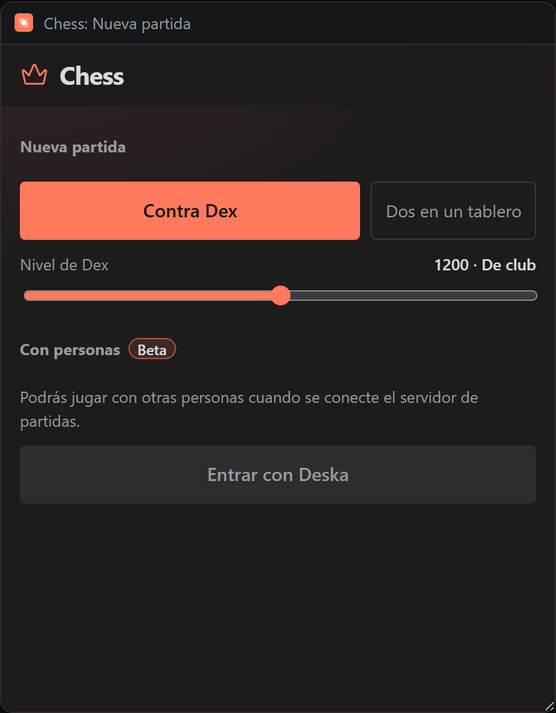
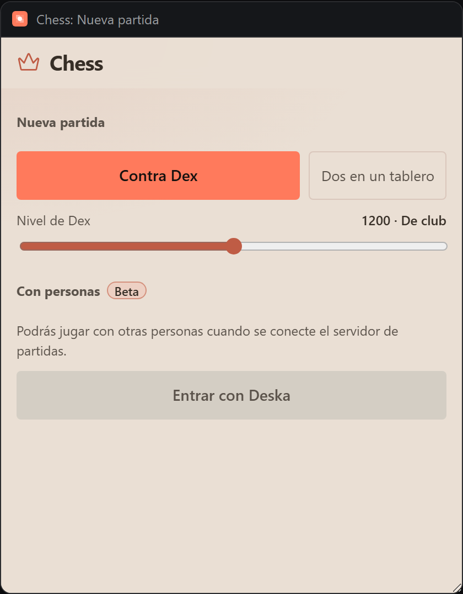

# Chess

La copia de desarrollo incluye el cliente de salas online y el acceso con Deska preparado.
El servicio HTTPS está pendiente: consulta [ONLINE.md](ONLINE.md) para el estado real, la configuración
y el contrato del servidor. El botón Online mantiene el acceso deshabilitado hasta configurarlo.
La promoción permite elegir dama, torre, alfil o caballo. Online está marcado como **Beta**.

Al abrir siempre sale el **menú de inicio**: continuar la partida anterior (la local y la online), empezar una contra el bot o en un mismo tablero, y, con el servidor conectado, tus rivales con quién está conectado, una búsqueda por nombre y los retos. El botón de la casa de la barra lo reabre.

En Apariencia: colores del tablero, estilo de piezas, coordenadas y **Tablero a pantalla completa**: el tablero ocupa todo el panel y las barras se superponen y se ocultan solas (el botón de arriba a la derecha las trae de vuelta). En un panel ancho, la barra lateral es estrecha y queda junto al tablero.

Controles del tablero:

- **Mover:** clic en la pieza y luego en la casilla, o mantener pulsada la pieza y arrastrarla. Soltarla fuera del tablero la devuelve.
- **Flechas y resaltados:** clic derecho y arrastrar dibuja una flecha; clic derecho en una casilla la resalta. Verde por defecto, Shift = rojo, Ctrl/⌘ = azul, Alt = amarillo. Repetir la misma marca la quita. Solo se ven en tu pantalla; un clic izquierdo o cualquier jugada las borra.
- **Premoves:** contra el bot u online, mientras mueve el otro lado, las mismas jugadas quedan en cola (casillas en violeta) y se juegan solas en tu turno si siguen siendo legales; si una ya no lo es, se cancelan las siguientes. Coronan a dama. Se cancelan con clic derecho o con clic en una casilla vacía. No existen en el modo de dos personas.
- **Avisos:** salen arriba del tablero con una X; los informativos se cierran a los 4 s y los errores a los 8 s.

Play chess against a bot you tune from 400 to 2000. You pick white, black or a random side when the panel starts, and the game is still there when the panel reloads.




## What it teaches

- **A game that survives a reload, with its history.** The start position and every move (as UCI text) are stored with the chosen side and where you are in the game, so a panel moved to a dock comes back where it was and Undo still works. Moves are replayed through the rules on load; a save that no longer replays is dropped with a message instead of crashing the panel.
- **Settings read per key.** `loadSettings()` keeps each stored value only if it is valid and falls back to the default for the rest, so an older save never breaks a newer panel. A failed save is shown in the status line.
- **Heavy work with no workers.** Deska's policy is `worker-src 'none'` and allows no WebAssembly, so Stockfish cannot run here. `engine.js` is a small alpha-beta search (transposition table, killer and history ordering) that runs on the page. It keeps its own stack instead of recursing, so it works in slices of a few milliseconds and the page paints between them; requests wait in a queue, one runs at a time, and a request the page no longer wants is dropped at the next slice. Nothing is allocated per node, so garbage collection does not pause the board. Weaker levels search less deep and blur each move's score with noise, so they sometimes pick a worse move. The levels are approximate, not measured Elo.
- **A canvas that follows the theme.** The page paints with Deska's tokens (`--deska-bg`, `--deska-accent`, `--deska-danger`) and repaints on `deska.on('theme')`. The App palette is the accent on the dark squares and a pale tint of it on the light ones.
- **Animation only while seen.** One `requestAnimationFrame` loop runs while the panel is visible and something blinks (a held piece); it sleeps otherwise, and `prefers-reduced-motion` turns the blink into a steady outline.
- **Motion that says something.** Pieces slide to their square, the held piece lifts with a shadow, the bot shows a breathing icon and three bouncing dots while it thinks, and the bot waits 0.65 to 1.25 s before it answers. Panels rise in; everything stops under `prefers-reduced-motion`.
- **Keyboard and screen readers.** Arrow keys move a cursor over the squares, Enter or Space picks and drops, and each move is announced once in a live region.

## How it plays

- The board fills the panel under the header and its coordinates sit inside the edge squares. Hover outlines the square in the color opposite to it, so it reads on any palette. Press a piece and the outline blinks, the square gets a tint, dots mark where it can go and a red outline marks what it can capture.
- Legal moves only: no move leaves your king in check. Castling, en passant, checkmate, stalemate, the fifty-move rule and bare kings are handled. Promotion lets you choose a queen, rook, bishop or knight.
- Bottom bar: the lightbulb asks the engine, at full strength whatever the bot's level, for the best move and draws an arrow on the board. When the game ends a result card (Victoria, Derrota or Tablas) lands after the last move with Jugar de nuevo, Cambiar de color and Ver tablero. Undo and Redo walk the game (against the bot they jump to your own turns, so going back never lands where the bot would instantly move), and a move made from an earlier position replaces what came after it. "Partida" opens a drawer that collapses to nothing and starts a new game with white, black or a random side.
- Appearance menu: board colors, four piece styles (Prisma, Trazo, Órbita and Clásico, the default), coordinates, and Reiniciar, which goes back to the choice of side. Bot menu: switch the bot off to play both sides, or set its level.

## Files

| File | Role |
| --- | --- |
| `rules.js` | Legal moves, castling, en passant, FEN, end of game. Pure functions. |
| `engine.js` | The bot: a flat-board alpha-beta search in time slices, its request queue, and the rating profiles. |
| `board.js` | Canvas drawing at device-pixel precision, piece styles, outline colors, arrows. |
| `marks.js` | Board palettes and the analysis marks (arrows, highlights, brushes). Pure functions. |
| `app.js` | Storage, game flow, pointer gestures (drag, arrows, premoves), menus, notices. |
| `index.html` | Includes an inline sprite of [Phosphor Icons](https://phosphoricons.com) (MIT), regular weight. |

## Permissions and hosts

None.

## Try it

```sh
npm run preview -- panels/chess
```

Then in Deska: Panel Library, Build a panel, Load a folder, and pick `panels/chess`.

## Notes

- `rules.js` and `engine.js` agree with the standard perft counts (197,281 nodes from the start at depth 4, 97,862 for the Kiwipete position at depth 3). `tools/chess/engine.test.mjs` checks the engine's counts, its position keys, a few tactics, cancellation and how long it holds the thread.
- The scope is `workspace`: one game per workspace.
